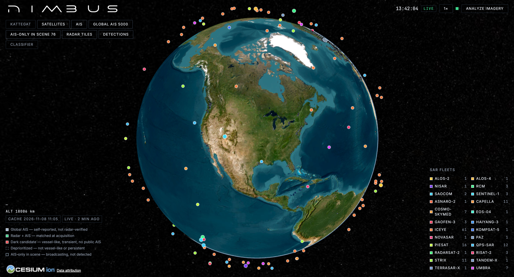

# Nimbus

Radar satellites do not stare at the ocean. Nimbus shows, on a 3D globe, when a patch of water sits inside an approximate SAR swath and when it does not — then opens a real Sentinel-1 scene and asks which bright radar returns have no public AIS nearby.



## The problem

A side-looking radar satellite only illuminates a strip offset from its ground track, and only while it is passing. Ships that want to avoid being watched can learn that schedule. Between passes the water is dark to SAR. Tasked fleets (ICEYE, Capella, Umbra, TerraSAR-X, COSMO-SkyMed) make a ground track even less of a picture: they point on demand.

## What Nimbus does

The globe is the product. Click **Kattegat** for a Sentinel-1D chip (2 Nov 2026). Green rings matched public AIS. Red rings are dark candidates (vessel-like, transient, no public AIS). Grey dashed rings are deprioritized (land, rocks, or not vessel-like). Hollow grey rings are AIS-only (broadcasting at the pass, not seen by radar). The classifier card and the detection inspector show how that call was made.

**Predict and act.** Dark candidates get a **Reacquire** control (reach rings, next SAR passes, clock scrub), a two-page **case file** (search box, next five passes with correct data-access levels, GPX/KML/GeoJSON exports, analyst sign-off), and a one-page **incident brief**. Gemini may write the prose; every number is produced by code and a numbers guard rejects invented figures. Reacquisition plans and reports are generated for Kattegat dark candidates.

Global ships are self-reported AIS positions shown for context. Only ships inside the Sentinel-1 scene are checked against radar.

## What's novel

Coverage-gap *timing* on top of detection, a learned ship-vs-clutter classifier, and honest provenance. Unmatched means not matched to public AIS. Tasked strips are labeled **possible coverage** and never close a gap. Every layer is tagged `LIVE`, `SNAPSHOT`, `MODELED`, or `PACKAGED`.

How the pieces fit: [docs/ARCHITECTURE.md](docs/ARCHITECTURE.md). Sources: [docs/DATA_SOURCES.md](docs/DATA_SOURCES.md). Look: [docs/DESIGN.md](docs/DESIGN.md). Databricks: [docs/DEPLOY.md](docs/DEPLOY.md).

## What we measured

Prepared from live sources on 7 Nov 2026. Re-running `make prepare` will move orbit numbers. The scene and AIS sample are committed.

| Fact | Value |
| --- | --- |
| Scene | `S1D_IW_GRDH_1SDV_20261102T052330_20261102T052402_005284_00A0D2_rtc` |
| Acquisition | 2026-11-02T05:23:46Z, Sentinel-1D, descending, Kattegat |
| CFAR detections | 21 |
| Matched to Danish AIS within 3 km | 18 |
| Unmatched | 3 |
| AIS vessels with pings in the sample | 255 |
| Predicted Sentinel-1D pass vs the STAC time | 1.0 second |
| Longest systematic gap on 2 Nov 2026 | 6.1 h (05:40Z–11:46Z) |
| Public SAR objects in the catalog | 151 |

The three unmatched returns are reviewed separately (see Ship classifier). Counts stay 21 / 18 / 3; review is an extra layer.

## Ship classifier

ResNet-18 on 64×64 Sentinel-1 VV chips at 10 m, trained on LS-SSDD-v1.0. Notebook: [`ml/nimbus_ship_classifier.ipynb`](ml/nimbus_ship_classifier.ipynb). Model card: [`backend/models/README.md`](backend/models/README.md).

| Held-out test (scenes 11–15) | |
| --- | --- |
| Average precision | 0.981 |
| Ships kept | 96.8% |
| CFAR false alarms rejected | 88.6% |
| Open-sea background rejected | 99.5% |

On the Kattegat scene at native 10 m, **17 of 18 AIS-confirmed ships** scored above the threshold (0.784). The miss is D015 (HAGLAND PREMIER, 0.5 km from shore, score 0.63).

| ID | Classifier | Persistence | AIS nearby | Status |
| --- | --- | --- | --- | --- |
| D002 | vessel-like (1.00) | transient | 5 AIS ships in 5 km / ±30 min, all matched to other detections 2.5–13.7 km away | Dark candidate: a separate, transient, vessel-like target |
| D016 | vessel-like (1.00) | transient | none in 5 km for the hour except STAVROLIT, matched to D003 10.9 km away | Dark candidate |
| D021 | not vessel-like (0.07) | persistent on every covered pass | — | Deprioritized (likely land or rocks) |

The classifier cannot tell a ship from a fixed structure, is weaker near shore, and was trained on 2020 Sentinel-1A/B. LS-SSDD-v1.0 prohibits commercial use; this model inherits that restriction.

## Ethics

Use this to understand coverage and to compare a radar detector with **public** AIS.

Do not use it to accuse a vessel, a company, or a person. An unmatched detection can be a ship whose AIS was not received, a ship whose reports were more than 10 minutes apart so interpolation was refused, a buoy or rock, or a CFAR false alarm.

“Inside a marine protected area” is a geographic flag, not evidence of fishing or any other activity.

Nimbus never labels a detection as a smuggler or as illegal. “Potential dark vessel” means “not matched to public AIS.” No public AIS is not evidence of wrongdoing.

## Run it

```bash
python run.py
```

or `make dev`. Open http://127.0.0.1:8741

`make test`  ·  `make lint`  ·  `make prepare` (re-download scene, AIS, MPAs, catalog)  ·  `make reference` (Natural Earth ports/land/countries for the report)

Copy `.env.example` to `.env` for optional Gemini, Fish Audio, Cesium ion, Tiger, GFW, AISStream. All stay off when unset. Set `AISSTREAM_API_KEY` and `AIS_GLOBAL_REFRESH=1` to refresh the global AIS layer in the background.

## Analyze imagery

Press **A** or **Analyze imagery**. Drop a JPEG/PNG/GeoTIFF (or pick an LS-SSDD / Kattegat sample). The bright-spot proposer and ResNet-18 classifier draw boxes, a pipeline funnel, and a score histogram.


Any Sentinel-1 GeoTIFF gets boxes and a location; AIS comparison works where AIS data is loaded (currently Danish waters, 2 Nov 2026).

## Team

HackRPI 2026.

## Built with

Python, FastAPI, CesiumJS, satellite.js / SGP4, ONNX Runtime, CelesTrak, Microsoft Planetary Computer, Danish Maritime Authority AIS, AISStream, EEA Natura 2000, LS-SSDD-v1.0, DuckDB. Optional: Gemini, Fish Audio, Databricks.

---

## Devpost questions

- What Problem are you trying to solve? `TODO(team)`
- What is your Solution? `TODO(team)`
- How original was your solution? `TODO(team)`
- Is it "better, best, or unique?" when compared to other similar solutions? `TODO(team)`
- How technically challenging was your solution? `TODO(team)`
- Describe your methods and efforts of the team to solve this problem. `TODO(team)`
