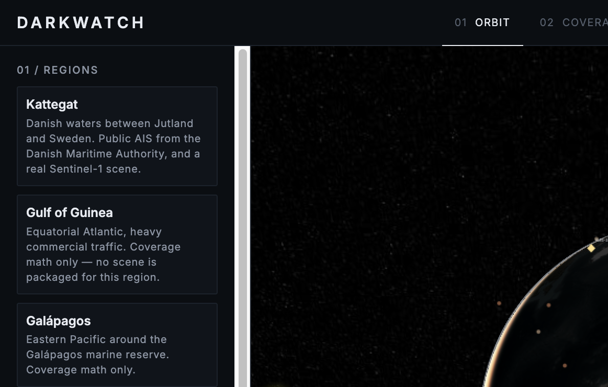

# DarkWatch

Radar satellites do not stare at the ocean. DarkWatch shows, on a 3D globe, when a patch of water sits inside an approximate SAR swath and when it does not — then opens a real Sentinel-1 scene and asks which bright radar returns have no public AIS nearby.



## The problem

A side-looking radar satellite only illuminates a strip offset from its ground track, and only while it is passing. Ships that want to avoid being watched can learn that schedule. Between passes the water is dark to SAR. Tasked fleets (ICEYE, Capella, Umbra, TerraSAR-X, COSMO-SkyMed) make a ground track even less of a picture: they point on demand.

## What DarkWatch does

1. **ORBIT** — 101 SAR objects from CelesTrak, propagated live. Click one for its mission registry entry and an approximate swath.
2. **COVERAGE** — pick a point; the next 48 hours of systematic swaths and the longest computed hole.
3. **SCENE** — a Sentinel-1D chip over the Kattegat (2 Nov 2026). Green rings matched public AIS. Red rings did not.
4. **ANALYSIS** — scene-day gaps, AIS reporting holes, and a chance baseline for “silences that start right after a pass.”

## What's novel

Coverage-gap *timing* on top of detection, and honest provenance. Unmatched means not matched to public AIS. Tasked strips are labeled **possible coverage** and never close a gap. Every layer is tagged `LIVE`, `SNAPSHOT`, `MODELED`, or `PACKAGED`.

How the pieces fit: [docs/ARCHITECTURE.md](docs/ARCHITECTURE.md). Sources: [docs/DATA_SOURCES.md](docs/DATA_SOURCES.md). Look: [docs/DESIGN.md](docs/DESIGN.md). Databricks: [docs/DEPLOY.md](docs/DEPLOY.md).

## What we measured

Prepared from live sources on 7 Nov 2026. Re-running `make prepare` will move orbit numbers. The scene and AIS sample are committed.

| Fact | Value |
| --- | --- |
| Scene | `S1D_IW_GRDH_1SDV_20261102T052330_20261102T052402_005284_00A0D2_rtc` |
| Acquisition | 2026-11-02T05:23:46Z, Sentinel-1D, descending, Kattegat |
| CFAR detections | 21 |
| Matched to Danish AIS within 3 km | 18 |
| Unmatched (potential dark vessels) | 3 |
| AIS vessels with pings in the sample | 255 |
| Predicted Sentinel-1D pass vs the STAC time | 1.0 second |
| Longest systematic gap on 2 Nov 2026 | 6.1 h (05:40Z–11:46Z) |

The three unmatched returns: **D002** (31.7 dB, 13.4 km offshore), **D016** (17.1 dB, inside Lilla Middelgrund), **D021** (13.9 dB, 0.4 km from shore — treat as possible coastal clutter).

## Ethics

Use this to understand coverage and to compare a radar detector with **public** AIS.

Do not use it to accuse a vessel, a company, or a person. An unmatched detection can be a ship whose AIS was not received, a ship whose reports were more than 10 minutes apart so interpolation was refused, a second radar peak next to a matched ship, a buoy or rock, or a CFAR false alarm.

“Inside a marine protected area” is a geographic flag, not evidence of fishing or any other activity.

DarkWatch never labels a detection as a smuggler or as illegal. “Potential dark vessel” means “not matched to public AIS.”

## Run it

```bash
python run.py
```

or `make dev`. Open http://127.0.0.1:8741

`make test`  ·  `make lint`  ·  `make prepare` (re-download scene, AIS, MPAs, catalog)

Copy `.env.example` to `.env` for optional Gemini, Fish Audio, Cesium ion, Tiger, GFW. All stay off when unset.

## Team

HackRPI 2026.

## Built with

Python, FastAPI, CesiumJS, satellite.js / SGP4, CelesTrak, Microsoft Planetary Computer, Danish Maritime Authority AIS, EEA Natura 2000, DuckDB. Optional: Gemini, Fish Audio, Databricks.

---

## Devpost questions

- What Problem are you trying to solve? `TODO(team)`
- What is your Solution? `TODO(team)`
- How original was your solution? `TODO(team)`
- Is it "better, best, or unique?" when compared to other similar solutions? `TODO(team)`
- How technically challenging was your solution? `TODO(team)`
- Describe your methods and efforts of the team to solve this problem. `TODO(team)`
