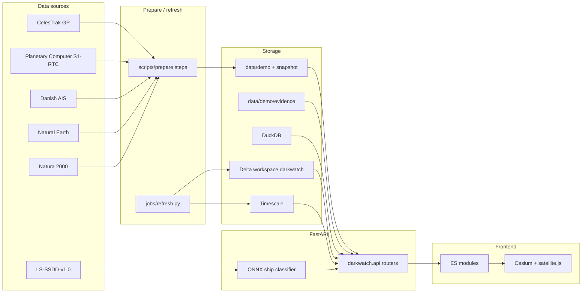

# Architecture

Read order at runtime: Tiger (if `TIGER_DATABASE_URL` is set and has a scene), then the Databricks SQL warehouse, then the bundled files in `data/demo`. `/api/health` reports `data.source` as `tiger`, `warehouse`, or `bundle`.

## Backend packages (`backend/darkwatch/`)

| Package | Job |
| --- | --- |
| `api/` | FastAPI app factory and routers. Static `frontend/` is mounted last. |
| `orbit/` | SGP4, swath geometry, pass windows, coverage gaps. `next_pass_over_polygon` is a reserved stub. |
| `catalog/` | Family rules, GP records, CelesTrak fetch, mission registry. |
| `detection/` | CA-CFAR, AIS matching, coverage reports. `Detector` protocol + `xview3_adapter` seam. `classifier.py` scores 64×64 chips (ONNX ResNet-18); it does not replace CFAR. |
| `imagery/` | Upload/sample pipeline (notebook proposer → chips → classifier → optional VOC / AIS). Planetary Computer TileJSON for the Kattegat radar overlay. |
| `ais/` | Sample loading, reporting silences, onset-after-pass baseline. |
| `geo/` | Regions and Natura 2000 helpers. |
| `storage/` | `Store` interface, DuckDB, Timescale, live snapshot picker. |
| `services/` | Briefs (Gemini or template), Fish Audio narration, GFW validation, evidence (`candidate_status`, `ais_context`). |
| `config.py` | Only module that reads environment variables. |
| `paths.py` | Repo root via `.darkwatch-root` + `data/`. |

## Frontend (`frontend/js/`)

Static files, native ES modules, no bundler. `state.js` is the only shared mutable store. Globe modules must not reach into panel DOM; they `set()` and panels subscribe or are called from `main.js`.

Kattegat radar tiles: `GET /api/scene/tiles` returns a Planetary Computer XYZ template (VV dB grayscale). The globe stacks Esri basemap → static `scene_preview.png` → those tiles → MPAs / AIS / detections. `#analyze` is a full-screen overlay for `POST /api/imagery/analyze`.

## Jobs

`backend/jobs/refresh.py` is the Databricks serverless task. It builds a `prepare.Target` for the newest Kattegat Sentinel-1 RTC scene that has a Danish AIS day zip, then reuses the same prepare steps as `make prepare`.
